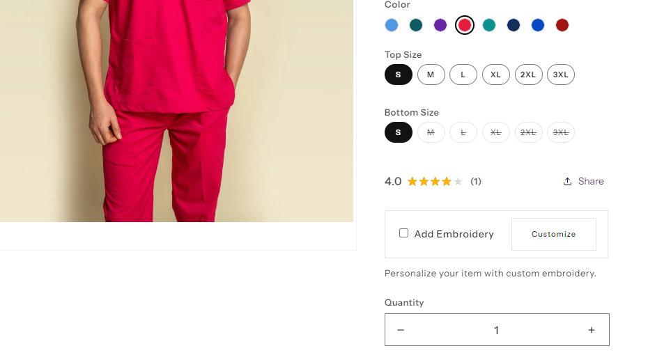
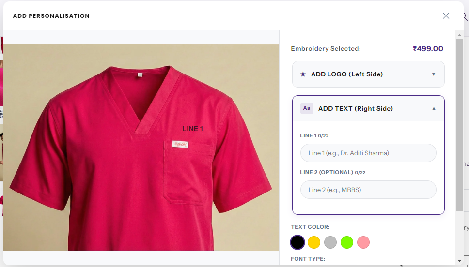

# Custom Embroidery Option on Product Page

**Project:** Maxzone Clothing  
**Type:** Custom Theme Feature  
**Date:** October 2026

## Output

## What It Is

A customization of an existing product-page snippet that provides customers with a custom embroidery option when purchasing products. The original snippet was not built entirely from scratch; custom logic was added to improve its cart behavior and compatibility with third-party checkout solutions.

## How It Works

- Adds custom functionality to the existing embroidery option snippet on the product page.
- Synchronizes the quantity of embroidery options with the product quantity selected by the customer, so the same number of options is added to the cart.
- Includes customizations to make the embroidery option compatible with third-party checkout.
- Extends the existing implementation rather than replacing the entire snippet.

## Setup

1. Add the customized snippet to the Shopify theme.
2. Render the snippet in the appropriate product-page area, following the existing implementation.
3. Verify that changing the product quantity updates the embroidery option quantity accordingly.
4. Test the cart and third-party checkout flow to confirm that the customization is carried through correctly.

## Where It Is Used

On product pages where customers can select a custom embroidery option.

## Files

- [`custom-embroidery-block.liquid`](./custom-embroidery-block.liquid) — full snipppet code
